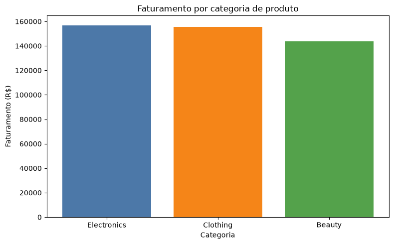
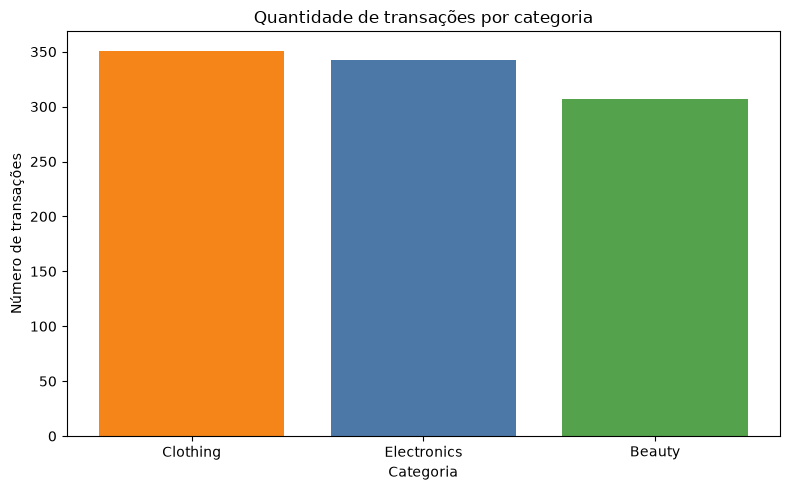
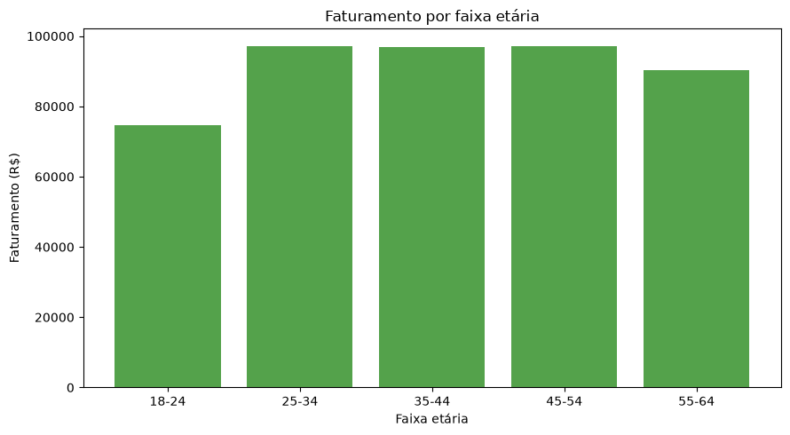
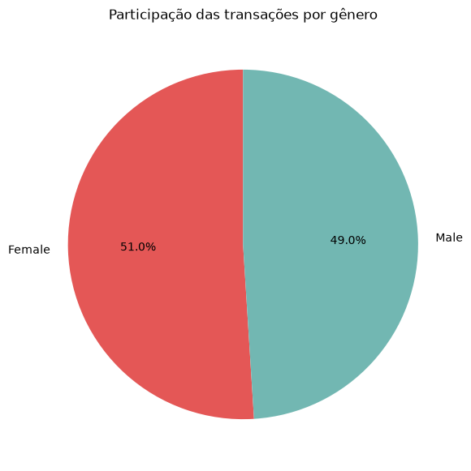
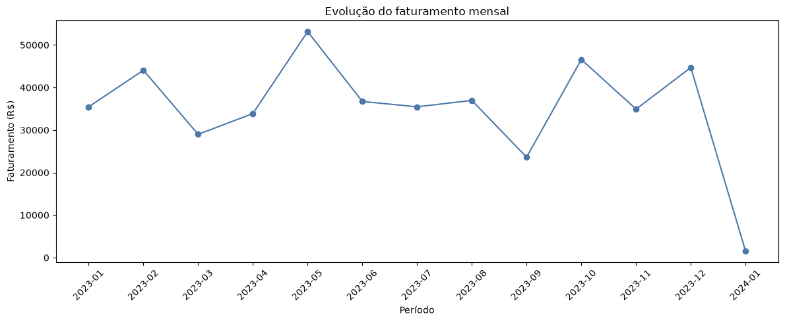
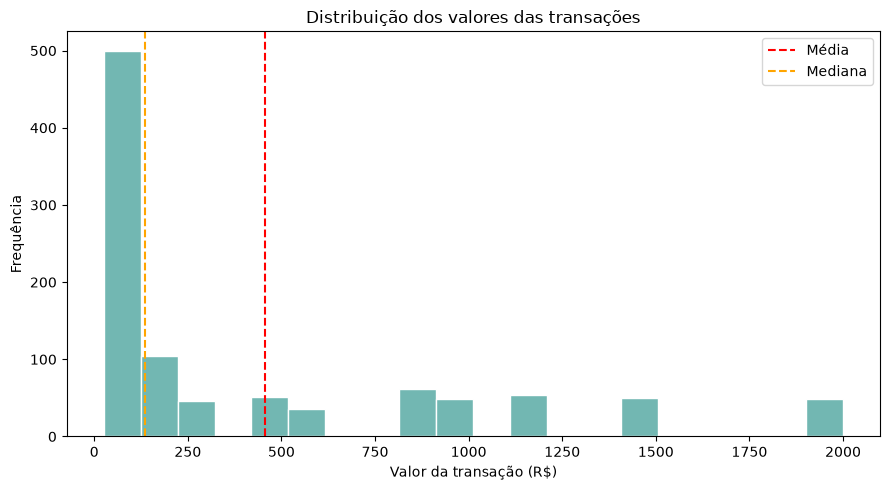

# 🛒 Análise de Vendas no Varejo (Retail Sales)

Projeto pessoal de análise exploratória de dados (EDA) em Python sobre 1.000 transações de uma loja de varejo. O trabalho cobre todo o fluxo: inspeção e tratamento da base, criação de variáveis derivadas, cálculo de indicadores e análise de frequências por perfil de cliente, categoria de produto e período.

## 🎯 Objetivos

- Avaliar a qualidade dos dados (nulos, duplicados, tipos e consistência dos valores).
- Preparar uma base tratada e enriquecida para análise.
- Calcular os principais indicadores de vendas (faturamento, ticket médio, itens vendidos).
- Entender **quem compra**, **o que compra** e **quando compra**.

## 📂 Estrutura do projeto

```
Projeto_Retail_Sales/
├── retail_sales_dataset.csv            # Base original
├── tratamento_retail_sales.ipynb       # Inspeção e tratamento dos dados
├── retail_sales_dataset_tratado.csv    # Base tratada e enriquecida
├── analises_retail_sales.ipynb         # Indicadores e análises
├── indicadores_gerais_calculados.csv   # KPIs gerais
├── frequencia_categoria.csv            # Transações por categoria de produto
├── frequencia_faixa_etaria.csv         # Transações por faixa etária
├── frequencia_genero.csv               # Transações por gênero
├── frequencia_mes.csv                  # Transações por mês
├── frequencia_preco_unitario.csv       # Transações por preço unitário
├── frequencia_quantidade.csv           # Transações por quantidade
├── imagens/                            # Gráficos gerados na análise
├── requirements.txt
└── README.md
```

## 🗃️ Dados

Base pública **Retail Sales Dataset** (Kaggle), com 1.000 linhas e 9 colunas:

| Coluna | Descrição |
|---|---|
| `Transaction ID` | Identificador da transação |
| `Date` | Data da compra |
| `Customer ID` | Identificador do cliente |
| `Gender` | Gênero do cliente |
| `Age` | Idade do cliente |
| `Product Category` | Categoria do produto (Beauty, Clothing, Electronics) |
| `Quantity` | Quantidade de itens |
| `Price per Unit` | Preço unitário |
| `Total Amount` | Valor total da transação |

Colunas criadas no tratamento: `Year`, `Month`, `Month Name`, `Age Group`, `Calculated Amount` (Quantidade × Preço unitário) e `Amount Difference` (validação do valor total).

## 🔧 Tratamento dos dados

1. Verificação de valores nulos (nenhum encontrado)
2. Verificação de linhas e IDs duplicados (nenhum encontrado)
3. Conversão da coluna `Date` para data
4. Padronização das colunas de texto (remoção de espaços)
5. Conferência das categorias de gênero e de produto
6. Criação de ano, mês e faixa etária
7. Validação do valor total: `Quantity × Price per Unit` bate com `Total Amount` em **100%** das transações

## 📊 Indicadores gerais

| Indicador | Valor |
|---|---|
| Total de transações | 1.000 |
| Clientes únicos | 1.000 |
| Faturamento total | R$ 456.000,00 |
| Ticket médio | R$ 456,00 |
| Mediana das transações | R$ 135,00 |
| Menor / maior transação | R$ 25,00 / R$ 2.000,00 |
| Itens vendidos | 2.514 |
| Itens por transação (média) | 2,51 |
| Idade média / mediana | 41,4 / 42 anos |

## 💡 Principais insights

- **Ticket médio bem acima da mediana** (R$ 456 vs. R$ 135): poucas compras de valor alto puxam a média para cima.
- **Categorias equilibradas:** Clothing tem mais transações (35,1%), mas **Electronics gera o maior faturamento** (R$ 156.905, ou 34,4% do total). Beauty fica atrás nos dois critérios.
- **Gênero equilibrado:** mulheres respondem por 51% das transações e 51,1% do faturamento.
- **Público adulto:** a faixa de 45–54 anos é a que mais compra (22,5% das transações), mas o **ticket médio cai com a idade**, de R$ 501 (18–24) para R$ 418 (55–64).
- **Sazonalidade:** **maio** é o melhor mês em transações (105) e faturamento (R$ 53.150). Outubro e dezembro vêm em seguida, e **setembro** é o mais fraco (R$ 23.620).
- **Preços e quantidades:** existem apenas 5 faixas de preço unitário (R$ 25, 30, 50, 300 e 500) e as compras vão de 1 a 4 itens, com distribuição praticamente uniforme.

## 📈 Gráficos

| Faturamento por categoria | Transações por categoria |
|---|---|
|  |  |

| Faturamento por faixa etária | Participação por gênero |
|---|---|
|  |  |

**Evolução do faturamento mensal**



> A queda em 2024-01 não é real: o mês tem apenas 2 transações registradas (a base termina em 01/01/2024).

**Distribuição dos valores das transações**



> ⚠️ **Limitações:** cada cliente aparece uma única vez, então não é possível analisar recorrência ou fidelização. O período vai de 01/01/2023 a 01/01/2024 (apenas 2 transações em 2024).

## 🛠️ Tecnologias

- Python 3.12+
- pandas · NumPy · Matplotlib
- Jupyter Notebook (VS Code)

## ▶️ Como executar

```bash
# 1. Clonar o repositório
git clone https://github.com/SEU_USUARIO/Projeto_Retail_Sales.git
cd Projeto_Retail_Sales

# 2. Criar e ativar um ambiente virtual
python -m venv .venv
.venv\Scripts\activate        # Windows
# source .venv/bin/activate   # Linux/macOS

# 3. Instalar as dependências
pip install -r requirements.txt
```

Depois, abra os notebooks no VS Code (ou no Jupyter) e execute nesta ordem:

1. `tratamento_retail_sales.ipynb`
2. `analises_retail_sales.ipynb`

## 👤 Autor

**Railson**: [GitHub](https://github.com/SEU_USUARIO) · [LinkedIn](https://www.linkedin.com/in/SEU_PERFIL)

## 📄 Licença

Distribuído sob a licença MIT. Veja o arquivo [LICENSE](LICENSE).
